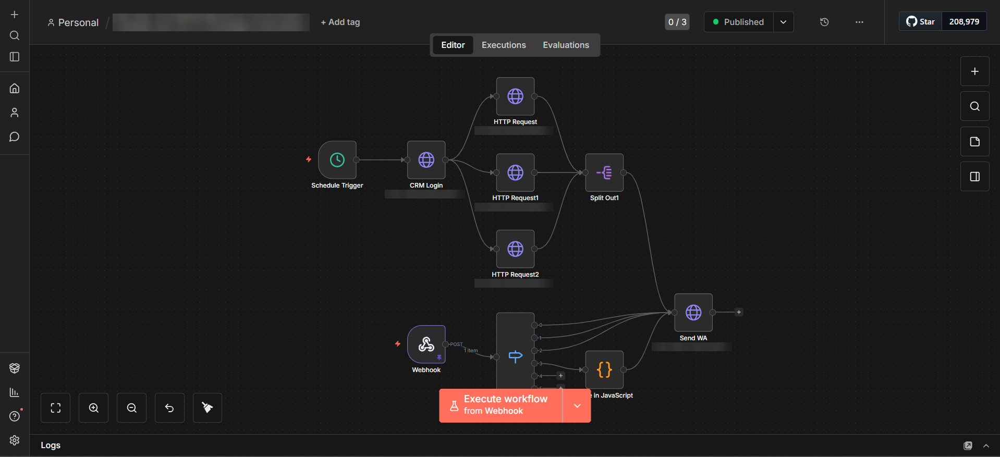
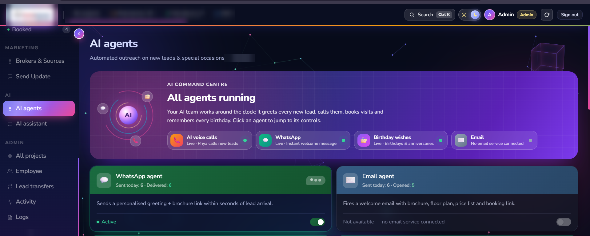

## WhatsApp-Automation-Real-Estate-CRM-Case-Study
# WhatsApp Automation for a Real Estate CRM — Case Study

Client project case study: event-driven WhatsApp automation connected to a real estate CRM — instant welcome messages, site-visit and booking confirmations, follow-up messages, birthday and anniversary wishes, and offer broadcasts — sent automatically through the WhatsApp Business API using a self-hosted n8n workflow.

## Overview

This is a client case study for a real estate developer in India. The sales team was sending WhatsApp messages to every enquiry by hand, which was slow, inconsistent, and easy to forget during busy days.

I built a WhatsApp automation layer around the client's CRM. Every important event in the CRM — a new lead, a scheduled site visit, a completed visit, a booking, a follow-up — now triggers the right WhatsApp template automatically, personalised with the customer's name, project details and the assigned salesperson's contact. A scheduled daily run also sends birthday and anniversary wishes and periodic follow-up messages without anyone having to remember them.

Each project has its own message templates, and the admin can switch the WhatsApp automation on or off from the CRM at any time.

## Live Website

Private internal system used by the client's sales team — no public demo.

## Project Type

Client Automation / CRM Integration

## Business Category

Real Estate Developer / Property Sales

## Key Features

* Instant welcome message when a new lead is added
* Site-visit confirmation when a visit is scheduled
* Post-visit thank-you message after a site visit
* Booking confirmation message when a unit is booked
* Follow-up acknowledgement message after each follow-up
* Automatic birthday and anniversary wishes (daily scheduled run)
* Periodic follow-up messages sent on a schedule
* Admin offer/update broadcasts to all leads of a project
* Cancelled leads automatically excluded from broadcasts
* Separate WhatsApp templates per project
* Personalisation with customer name, project and salesperson details
* Bulk-imported leads only receive visit/booking messages if the event is recent (no messages to old records)
* Admin on/off switch for the WhatsApp automation inside the CRM
* "Sent today" and "Delivered" counters on the CRM's AI agents page

## How It Works

The automation runs as one n8n workflow with two branches:

**Real-time branch (CRM events)**

1. Something happens in the CRM — a new lead, a scheduled or completed visit, a booking, a follow-up, or a broadcast.
2. The CRM sends the event, with the lead and project details, to the workflow's webhook.
3. A router sends each event type down its own path, and a small JavaScript step prepares the message data where needed.
4. The matching project template is filled in and sent through the WhatsApp Business API.

**Scheduled branch (daily)**

1. A schedule trigger starts the run every day.
2. The workflow signs in to the CRM's API and fetches today's birthdays, anniversaries and due follow-up messages.
3. The list is split into individual leads, and each one receives its WhatsApp template.

## Challenges & Solutions

* **Template naming differences** between the WhatsApp provider's dashboard and its API — standardised template names per project in the CRM settings.
* **Not messaging old customers by mistake** — bulk-imported leads only trigger visit/booking messages when the visit or booking date is recent.
* **Many event types, one workflow** — a single webhook with a router keeps every message type in one place that is easy to maintain.
* **Daily messages without manual work** — a scheduled branch handles birthdays, anniversaries and periodic follow-ups automatically.
* **Control for the business** — the automation can be paused from the CRM without touching the workflow.

## Tech Stack

* n8n (self-hosted workflow automation)
* WhatsApp Business API (via a WhatsApp Business Solution Provider)
* Node.js
* Express.js (REST API + webhooks)
* MySQL
* JavaScript
* HTML, CSS, JavaScript (CRM front end)
* Nginx + PM2 on a Linux VPS
* Claude-assisted development

## My Role

I worked on the complete WhatsApp automation: mapping each CRM event to a WhatsApp message with the client, building the n8n workflow (real-time webhook branch and scheduled daily branch), connecting the WhatsApp Business API, adding the CRM-side triggers and per-project template settings, the rules that protect old imported leads from unwanted messages, the on/off control, and a quick guide for the sales team. I used Claude to assist in building and improving the system for a real client project.

## Screenshots

### WhatsApp Automation Workflow (n8n)

### AI Agents & Automation Controls

## Status

Completed and live — in daily use by the client's sales team.

## Confidentiality Note

This repository is a portfolio case study. The client's name, project names, CRM address, customer and lead data, phone numbers, customer conversations, message templates, WhatsApp provider account details, API keys, webhook URLs, account credentials, server details, and private source code are not included. Screenshots have identifying information hidden.
